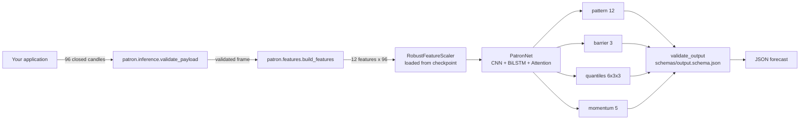
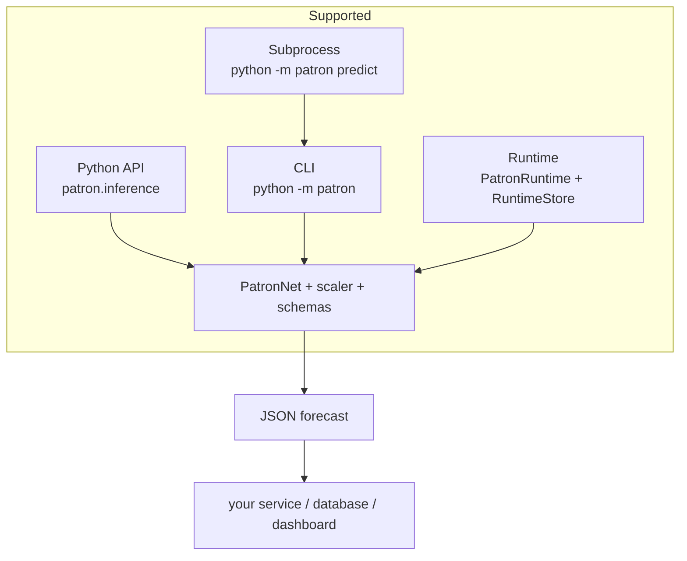
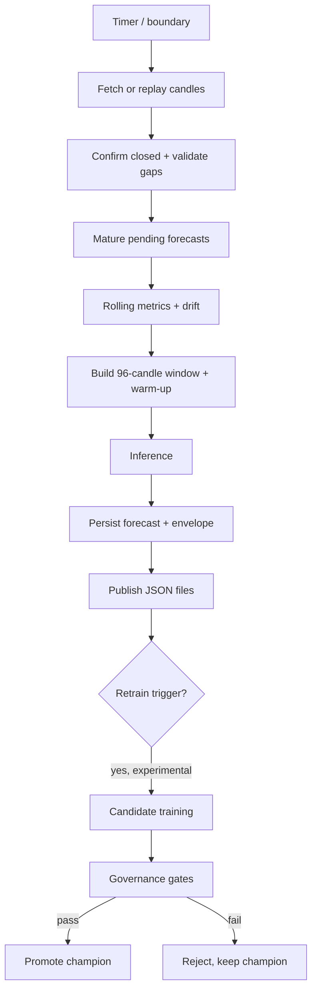

# PATRON Integration Guide

**Pattern Recognition & Outcome Network — universal integration guide**

| | |
|---|---|
| Release | `v1.0.0-beta.1` (package `1.0.0b1`) |
| Model version | `1.0.0` (272,618 trainable parameters) |
| Contract | 96 candles × 12 features → 6 candles / 90 minutes |
| Python | 3.12 (`requires-python >= 3.12`, tested on 3.12.10) |
| Status | **beta / experimental research software — not financial advice, no order execution** |

This guide is written against the code in this release. Every Python snippet was executed
against it; every CLI command shown exists and was run. Where something is illustrative
rather than shipped, it is marked **pseudocode**.

## Table of contents

1. [Introduction](#1-introduction)
2. [Architecture overview](#2-architecture-overview)
3. [Installation](#3-installation)
4. [Integration methods](#4-integration-methods)
5. [Input data specification](#5-input-data-specification)
6. [Prediction output documentation](#6-prediction-output-documentation)
7. [Integration examples](#7-integration-examples)
8. [Configuration](#8-configuration)
9. [Training and fine-tuning](#9-training-and-fine-tuning)
10. [Autonomous runtime integration](#10-autonomous-runtime-integration)
11. [Error handling](#11-error-handling)
12. [Performance and resource requirements](#12-performance-and-resource-requirements)
13. [Security](#13-security)
14. [Troubleshooting](#14-troubleshooting)
15. [Complete integration checklist](#15-complete-integration-checklist)
16. [Licence and attribution](#16-licence-and-attribution)
17. [Disclaimer](#17-disclaimer)

---

## 1. Introduction

PATRON stands for **Pattern Recognition & Outcome Network**. It is a small, CPU-friendly
PyTorch model that reads the last **96 closed 15-minute BTC/USDT candles** and produces a
multi-head forecast for the **next 6 candles (90 minutes)**:

- which classic candlestick **patterns** are present,
- the probability that a **take-profit, stop-loss or timeout** happens first,
- **high / low / close quantiles** for each of the next six candles,
- a five-class **momentum** classification.

It exists to answer a research question — *does a compact convolutional-recurrent model
extract tradable structure from short-horizon crypto candles?* — with an honest evaluation
apparatus (walk-forward splits, purge/embargo, baselines, calibration, drift monitoring)
instead of a trading bot.

**What PATRON does**

- Turns a validated 96-candle window into a schema-validated JSON forecast.
- Persists forecasts, matures them against realised candles, and scores itself.
- Provides a reproducible training pipeline with a frozen feature/label contract.
- Gives you a library, a CLI, a health check and an autonomous runtime to build on.

**What PATRON does not do**

- It does not place, size or manage orders. `live_order_execution` is `false` in
  `config/model_config.yaml` and no exchange credentials are used anywhere.
- It does not guarantee accuracy or profit. On the held-out test split the barrier head is
  at 38.1 % three-class accuracy and the momentum head is near chance — see
  [`LIMITATIONS.md`](LIMITATIONS.md) and [`MODEL_CARD.md`](MODEL_CARD.md).
- It does not fetch data for you unless you use its collector
  (`patron.data`), the runtime's source adapters, or the CLI/runtime commands.
- It does not support symbols other than `BTC/USDT` 15m without retraining and a new
  contract (the schema pins `symbol` and `timeframe`).

Status: **beta**. Treat every output as a probabilistic estimate from an experimental
model, and read [§17](#17-disclaimer) before you build anything on it.

---

## 2. Architecture overview

```
96 × 12 input window (float32, oldest → newest)
        │
        ▼
Linear input projection 12 → 32
        │
        ▼
3 × ConvBlock (channels 32, 64, 64; kernels 3, 5, 7; GELU + BatchNorm + residual)
        │
        ▼
1-layer bidirectional LSTM (64 units per direction → 128)
        │
        ▼
Multi-head self-attention (4 heads, dim 128) + attention pooling
        │
        ▼
Shared trunk 64 (dropout 0.15)
   ├── pattern head   → 12 logits (sigmoid, multi-label)
   ├── barrier head   → 3 logits (softmax: tp_first / sl_first / timeout)
   ├── quantile head  → 6 steps × 3 fields × 3 quantiles (q10/q50/q90)
   └── momentum head  → 5 logits (softmax over momentum classes)
```

- **CNN** extracts local candle geometry (bodies, wicks, short sequences).
- **BiLSTM** models order and persistence across the 96-bar window.
- **Attention** pools the whole window instead of relying on the last hidden state, which
  is why the model tolerates the pattern starting anywhere in the window.
- Parameter count is asserted at **272,618**; the contract tests fail if it changes.



Four heads, documented as implemented in `src/patron/models/patron_net.py` and
`config/model_config.yaml`:

| Head | Output | Activation | Classes / shape |
|---|---|---|---|
| Candlestick patterns | `pattern_scores` | sigmoid (independent tags) | 12 tags from `forecast.pattern_tags` |
| Triple barrier | `barrier_probabilities` | softmax (sums to 1) | `tp_first`, `sl_first`, `timeout` |
| Range quantiles | `range_quantiles` | direct regression | 6 steps × {high, low, close} × {q10, q50, q90} |
| Momentum | `momentum.class_probabilities` | softmax (sums to 1) | strong_bullish, bullish, sideways, bearish, strong_bearish |

---

## 3. Installation

### 3.1 Requirements

- **Python 3.12** (the package declares `>=3.12`; tested on 3.12.10, Windows 11).
- ~2 GB free disk for the environment (CPU torch wheel is the large piece).
- No GPU required. CUDA is **not** installed or required; the release is CPU-only.
- No exchange account, API key or network access is needed for inference, training on an
  existing dataset, or the offline runtime.

### 3.2 Windows (PowerShell)

```powershell
# from the release directory (the one containing this file)
powershell -ExecutionPolicy Bypass -File scripts\install.ps1
.\.venv\Scripts\Activate.ps1
python -m patron health
python -m patron --version
```

`install.ps1` creates `.venv`, installs `requirements.txt` (CPU torch), installs the
project in editable mode, verifies a torch matrix multiply and runs the health check.
It stops with a clear message if Python is missing or older than 3.12.

Manual equivalent:

```powershell
python -m venv .venv
.\.venv\Scripts\Activate.ps1
python -m pip install --upgrade pip
python -m pip install -r requirements.txt
python -m pip install -e .          # or: pip install .\patron-1.0.0b1-py3-none-any.whl
python -m patron health
```

### 3.3 Linux / macOS

```bash
bash scripts/install.sh
source .venv/bin/activate
python -m patron health
```

Manual equivalent:

```bash
python3.12 -m venv .venv
source .venv/bin/activate
python -m pip install --upgrade pip
python -m pip install -r requirements.txt
python -m pip install -e .
python -m patron health
```

macOS: the same steps are expected to work (all dependencies are CPU wheels), but macOS
has **not** been tested for this release — treat it as unsupported-but-plausible and
report what you find. On Apple silicon install the standard `torch` wheel; do not add
CUDA/ROCm indexes.

### 3.4 Wheel install (no repository checkout)

```bash
python -m venv .venv
source .venv/bin/activate            # Windows: .\.venv\Scripts\Activate.ps1
python -m pip install -r requirements.txt
python -m pip install patron-1.0.0b1-py3-none-any.whl
python -m patron --version           # patron 1.0.0b1
python -m patron health              # PASS/WARN/FAIL report
```

The wheel bundles the JSON schemas (`patron/schemas/`), so inference works from any
working directory. The repository copy in `schemas/` is canonical; a test asserts the two
are byte-identical.

### 3.5 GPU (optional, unsupported)

PATRON runs on CPU. A CUDA build of torch is not required and not tested; if you install
one yourself, `load_checkpoint(..., map_location="cpu")` still loads weights to CPU and
the code paths in this release do not call `.to("cuda")`. There is no supported GPU
training script in this release, and nothing will silently switch to paid cloud compute.

### 3.6 Verify the install

```bash
python -m patron health
python -m patron health --json          # machine-readable, same checks
python -m patron health --strict        # exit 1 on WARN as well as FAIL
```

Exit code is `0` for PASS/WARN and `1` for FAIL (with `--strict`, WARN also returns `1`).
See [`INSTALLATION.md`](INSTALLATION.md) for the check list and prerequisites.

---

## 4. Integration methods

PATRON exposes three real integration surfaces — a Python API, a CLI, and the runtime's
own store/publisher — plus one adapter pattern (subprocess) for non-Python callers.



### Method A — Python integration (recommended)

```python
import json
from pathlib import Path

from patron.inference.pipeline import (
    InputValidationError,
    load_predictor,
    predict,
    validate_output,
)

# 1. load once per process (checkpoint + config + scaler + schemas)
predictor = load_predictor(
    checkpoint_path="experiments/patron_v2_20261114-203859/best.pt",
    warmup_path="data/clean/BTCUSDT/15m.parquet",  # 384 bars of history before the window
)

# 2. build the payload (see §5 for the contract)
payload = json.loads(Path("examples/sample_input.json").read_text(encoding="utf-8"))

# 3. run inference
try:
    result = predict(payload, predictor)
except InputValidationError as exc:
    raise SystemExit(f"bad input: {exc}")

# 4. validate against schemas/output.schema.json, then use it
validate_output(result)
if result["status"] == "OK":
    print(result["barrier_probabilities"]["tp_first"], result["as_of"])
```

Observed output for `examples/sample_input.json` (status `OK`, `as_of`
`2026-11-14T13:00:00+00:00`, `tp_first` `0.432285`).

Notes that matter:

- `load_predictor` reads the **config embedded in the checkpoint** unless you pass
  `config_path=`. A checkpoint and a config that disagree will fail at
  `load_state_dict`, which is the intended behaviour.
- The scaler is loaded from the checkpoint; **never** normalise features yourself.
- `predict` builds features internally; you never hand it 12 floats.
- `predict(payload, predictor, now=None)` accepts an explicit `now` (UTC `datetime`) for
  reproducible tests; production calls should omit it.

Lower-level access, if you need embeddings or your own batching:

```python
from patron.config import load_config
from patron.models.patron_net import build_model, count_parameters
from patron.training.trainer import load_checkpoint

cfg = load_config("config/model_config.yaml")
model = build_model(cfg)
print(count_parameters(model))          # 272618

payload = load_checkpoint("experiments/patron_v2_20261114-203859/best.pt")  # weights_only=True
model.load_state_dict(payload["model_state"])
model.eval()
scaler = payload["scaler"]              # dict form, see patron.features.scaler
feature_order = payload["feature_order"]  # must equal patron.features.schema.FEATURE_ORDER
```

### Method B — CLI integration

Every command below exists in this release (`python -m patron --help`).

| Task | Command |
|---|---|
| Health | `python -m patron health [--json] [--strict] [--dataset PATH] [--checkpoint PATH] [--db PATH]` |
| One forecast | `python -m patron predict --input examples/sample_input.json --checkpoint PATH [--warmup PATH] [--output PATH]` |
| Evaluate a checkpoint | `python -m patron evaluate --checkpoint PATH [--dataset PATH] [--out PATH] [--no-baselines]` |
| Train a candidate | `python -m patron train [--config PATH] [--dataset PATH] [--epochs N] [--batch-size N] [--train-stride N] [--threads N] [--seed N] [--run-name NAME] [--dry-run]` |
| Runtime state | `python -m patron runtime status` |
| One runtime cycle | `python -m patron runtime once [--offline-source PARQUET] [--now ISO] [--db PATH] [--no-train]` |
| Continuous runtime | `python -m patron runtime serve [--max-cycles N]` |
| Mature forecasts | `python -m patron runtime mature` |
| Roll back champion | `python -m patron runtime rollback [--version NAME]` |
| Runtime health | `python -m patron runtime health` |
| List experiments | `python -m patron experiment list [--json]` |
| Compare experiments | `python -m patron experiment compare --runs RUN_A RUN_B` |

Exit codes (stable, used by the subprocess adapter): `0` success · `1` failed check or
runtime cycle · `2` missing input/checkpoint · `3` invalid input · `4` model produced no
usable output (`NO_OUTPUT`).

`predict` writes the same JSON to `--output` (default
`reports/predictions/latest.json`) and to stdout, followed by a `written: <path>` line —
parse the file, not stdout.

### Method C — Subprocess integration (verified)

For non-Python callers, or to isolate torch in its own process:

```python
import json
import subprocess
import sys
from pathlib import Path

output = Path("forecasts/latest.json")
command = [
    sys.executable, "-m", "patron", "predict",
    "--input", "examples/sample_input.json",
    "--checkpoint", "experiments/patron_v2_20261114-203859/best.pt",
    "--warmup", "data/clean/BTCUSDT/15m.parquet",
    "--output", str(output),
]

try:
    proc = subprocess.run(  # list form: no shell, no quoting/injection issues
        command,
        capture_output=True,
        text=True,
        timeout=300,          # inference is ~0.1 s; 300 s covers a cold model load
        check=False,
    )
except subprocess.TimeoutExpired:
    raise RuntimeError("PATRON prediction timed out")

if proc.returncode == 0:
    forecast = json.loads(output.read_text(encoding="utf-8"))
elif proc.returncode == 3:
    raise ValueError(f"invalid input: {proc.stderr.strip()}")
elif proc.returncode == 4:
    forecast = json.loads(output.read_text(encoding="utf-8"))  # status == "NO_OUTPUT"
else:
    raise RuntimeError(f"PATRON failed ({proc.returncode}): {proc.stderr.strip()}")
```

Verified behaviour on this release: exit `0` with a valid JSON file for
`examples/sample_input.json`; exit `3` with `input validation error: candles must be
ordered oldest -> newest` for `examples/invalid_input.json`.

Do not use `shell=True`, do not interpolate untrusted strings into a command line, and
always set a timeout.

### Method D — Existing application integration

| Target | Supported? | How |
|---|---|---|
| Existing Python project | **Yes** | import `patron.inference`, pin `torch`/`numpy`/`pandas` versions |
| Backend service (FastAPI/Flask/Django) | **Yes**, with your own auth | load one `Predictor` at startup, call `predict` per request (§7 example 2 is pseudocode for the HTTP layer) |
| Research notebook / pipeline | **Yes** | feed a DataFrame built from your warehouse (§7 example 1 is executable) |
| Dashboard | **Yes** (read JSON) | publish `forecasts/latest.json` or serve it from your own endpoint |
| Other AI systems | **Yes** (as a feature/tool) | expose the JSON forecast as a tool result; validate it before use |
| Exchange order execution | **No** | not implemented in this release; `live_order_execution: false` |
| Non-15m timeframes / other symbols | **No** | contract is pinned; changing it requires retraining and a schema change |

PATRON ships no HTTP server: serving predictions over a network is *your* service, and it
must add authentication, rate limiting and TLS (§13).

---

## 5. Input data specification

The contract is `schemas/input.schema.json` plus semantic checks in
`patron.inference.pipeline.validate_payload`.

| Field | Requirement |
|---|---|
| `symbol` | exactly `"BTC/USDT"` |
| `timeframe` | exactly `"15m"` |
| `candles` | array of **exactly 96** objects, oldest → newest |
| `candles[].timestamp` | ISO-8601 date-time of the candle **open**, UTC (`2026-11-13T13:00:00+00:00` or `...Z`); a trailing offset is accepted |
| `candles[].open/high/low/close` | numbers `> 0` |
| `candles[].volume` | number `>= 0` |
| extras | rejected (`additionalProperties: false` on payload and candles) |
| `context` | optional object (`last_closed_1h`, `last_closed_4h`); accepted and ignored by v1 heads |

Semantic rules enforced after schema validation:

- timestamps parse as date-times, strictly increasing (`oldest -> newest`), no duplicates;
- **exactly 15 minutes** between consecutive timestamps, no gaps;
- OHLC consistency: `high >= max(open, close, low)`, `low <= min(open, close, high)`;
- volume non-negative, prices strictly positive;
- the last candle's **close** must not be in the future
  (`runtime.reject_unclosed_candle: true`);
- the window length must equal `input.sequence_length` (96).

### 5.1 Why 96 candles and 12 features

The model input is a fixed 96 × 12 tensor: 96 consecutive 15-minute bars (24 hours) and
12 engineered features in a **frozen order** (`config/model_config.yaml` →
`input.feature_order`, mirrored in `patron.features.schema.FEATURE_ORDER`):

```
open_rel, high_rel, low_rel, close_rel, volume_log_rel, body_to_range,
atr14_pct, rsi14_scaled, ema9_gap, ema21_gap, volume_spike, htf_trend
```

All features are computed by `patron.features.builder.build_features` and then scaled by
the checkpoint's `RobustFeatureScaler` inside `predict`. Features are relative
(returns/log-ratios/gaps), never raw prices, so the scale stays stable across price
levels. **Do not reorder, drop or add features** — the scaler and the weights are bound
to this order, and `feature_order` is stored in the checkpoint to detect mismatches.

### 5.2 Warm-up requirement

Two features look further back than 96 bars: the 96-bar volume baseline and the 4-hour
ATR warm-up (`atr_period: 14` on `1h`/`4h` context). Supply **at least 384 contiguous
15-minute bars immediately before your window** (4 days) via `warmup_path=`, the CLI
`--warmup`, or the runtime's `history.warmup_bars: 384`.

If warm-up history is missing or not contiguous with the window, `predict` refuses to
invent values and returns `status: "NO_OUTPUT"` with a warning:

```json
{
  "status": "NO_OUTPUT",
  "data_quality": {
    "valid": false,
    "closed_candles": 0,
    "sequence_length": 96,
    "warnings": [
      "no warm-up history available",
      "insufficient history for a 96-bar volume baseline and 4h ATR warm-up; features of the final candle would be invalid (NO_OUTPUT)"
    ]
  }
}
```

Patience beats cleverness here: a made-up warm-up produces plausible-looking but wrong
forecasts. Prefer returning `NO_OUTPUT` to your users.

### 5.3 Closed candles only

A 15-minute candle is only usable after its close. If you pass a candle whose close time
is in the future, `predict` raises `InputValidationError: last candle closes at ... which
is in the future`. Never include the forming candle: its OHLC change minute by minute, so
the features (and therefore the forecast) would change with them and the "forecast" would
be peeking at partially realised data.

### 5.4 Verified payload example

`examples/sample_input.json` is a real 96-candle window (abridged here; the file contains
all 96 candles and validates):

```json
{
  "symbol": "BTC/USDT",
  "timeframe": "15m",
  "candles": [
    {"timestamp": "2026-11-13T13:00:00+00:00", "open": 69204.36, "high": 69276.01, "low": 69106.0, "close": 69224.01, "volume": 203.05473},
    {"timestamp": "2026-11-13T13:15:00+00:00", "open": 69224.02, "high": 69324.01, "low": 69162.22, "close": 69246.01, "volume": 179.1609}
  ]
}
```

Only two of the 96 candles are shown; the real file runs from `2026-11-13T13:00:00+00:00`
to `2026-11-14T12:45:00+00:00` in ascending order.

Building the same payload from a DataFrame (this exact code produced an identical payload
and an `OK` forecast):

```python
import pandas as pd

frame = pd.read_parquet("data/clean/BTCUSDT/15m.parquet")
frame["timestamp_open"] = pd.to_datetime(frame["timestamp_open"], utc=True)
window = frame[frame["timestamp_open"] <= pd.Timestamp("2026-11-14T13:00:00Z")].tail(96)

payload = {
    "symbol": "BTC/USDT",
    "timeframe": "15m",
    "candles": [
        {
            "timestamp": row.timestamp_open.isoformat(),
            "open": float(row.open),
            "high": float(row.high),
            "low": float(row.low),
            "close": float(row.close),
            "volume": float(row.volume),
        }
        for row in window.itertuples(index=False)
    ],
}
```

`frame` in this repository uses `timestamp_open`; if your data uses `timestamp`/`time`,
rename before the comprehension. Rows must already be sorted ascending.

---

## 6. Prediction output documentation

Output is validated against `schemas/output.schema.json` (`additionalProperties: false`).

| Field | Type | Meaning |
|---|---|---|
| `status` | `"OK"` \| `"NO_OUTPUT"` | `NO_OUTPUT` carries zeros plus `data_quality.warnings`; never trade on it |
| `symbol` | string | `"BTC/USDT"` |
| `as_of` | ISO-8601 | **close time** of the last input candle |
| `horizon_minutes` | const `90` | 6 × 15 minutes |
| `model_version` | string | `patron-1.0.0` (config `project.version`) |
| `feature_version` | string | `features-1.0.0` |
| `pattern_scores` | object of 12 floats 0–1 | independent sigmoid probabilities per pattern tag |
| `barrier_probabilities` | object of 3 floats | softmax over `tp_first`, `sl_first`, `timeout`; sums to 1 |
| `range_quantiles` | array of 6 objects | one per future candle: `step` 1–6, `minutes_ahead` 15–90, and `high`/`low`/`close` each `{q10, q50, q90}` |
| `momentum.class_probabilities` | object of 5 floats | softmax; sums to 1 |
| `momentum.predicted_class` | string | argmax of the above |
| `data_quality` | object | `valid`, `closed_candles` (96), `sequence_length` (96), `warnings` |

### 6.1 Interpretation

- **Pattern probabilities** are multi-label: several patterns can be high at once. They
  are *presence* scores, not a single classification, and are uncalibrated.
- **Barrier probabilities** answer "within the next 90 minutes, which barrier does price
  reach first?" with barriers `1.5 × ATR14` up (take profit) and `1.0 × ATR14` down (stop
  loss), timeout otherwise. Same-candle ambiguity is excluded from the training loss.
- **Quantiles** are **relative to the last input close** (fractional returns):
  `price ≈ last_close × (1 + q)`. `q50` is the median estimate; `q10..q90` is an 80 %
  central band. On the test split that band is wider than the realised 80 % interval
  (see [`MODEL_CARD.md`](MODEL_CARD.md)) — treat it as conservative, not calibrated.
- **Momentum** classes are thresholds on the 90-minute normalised return
  (`[-1.0, -0.35, 0.35, 1.0]` in ATR units), not raw percentages. On the test split this
  head is at chance (macro-F1 0.224); do not use it alone.
- **Confidence**: no field is calibrated except the barrier head (temperature scaling is
  applied at training time and stored in the checkpoint). Probabilities are model scores
  from a beta model trained on ~4.6 years of one symbol; they are not guaranteed
  frequencies.

### 6.2 Real output (excerpt, 96-candle BTC/USDT window)

The `range_quantiles` array below is truncated to step 6 for readability; a real response
contains all six steps (the schema requires exactly 6).

```json
{
  "status": "OK",
  "symbol": "BTC/USDT",
  "as_of": "2026-11-14T13:00:00+00:00",
  "horizon_minutes": 90,
  "model_version": "patron-1.0.0",
  "feature_version": "features-1.0.0",
  "pattern_scores": {
    "doji": 0.074356,
    "hammer": 0.030103,
    "inverted_hammer": 0.010828,
    "hanging_man": 0.013756,
    "shooting_star": 0.014848,
    "bullish_engulfing": 0.059839,
    "bearish_engulfing": 0.121464,
    "piercing_line": 0.00955,
    "dark_cloud_cover": 0.010361,
    "morning_star": 0.010517,
    "evening_star": 0.012566,
    "three_candle_continuation_reversal": 0.512542
  },
  "barrier_probabilities": {
    "tp_first": 0.432285,
    "sl_first": 0.441476,
    "timeout": 0.126239
  },
  "range_quantiles": [
    {
      "step": 6,
      "minutes_ahead": 90,
      "high": {"q10": -0.003791, "q50": 0.00229, "q90": 0.008676},
      "low":  {"q10": -0.008151, "q50": -0.00051, "q90": 0.005099},
      "close": {"q10": -0.005278, "q50": 0.000665, "q90": 0.008768}
    }
  ],
  "momentum": {
    "class_probabilities": {
      "strong_bullish": 0.298328,
      "bullish": 0.181435,
      "sideways": 0.142717,
      "bearish": 0.12594,
      "strong_bearish": 0.25158
    },
    "predicted_class": "strong_bullish"
  },
  "data_quality": {"valid": true, "closed_candles": 96, "sequence_length": 96, "warnings": []}
}
```

Barrier probabilities sum to 0.999999 after 6-decimal rounding — do not assume exact 1.0
equality in your code; normalise if you need to.

---

## 7. Integration examples

### Example 1 — forecast from a Python application (executable)

```python
import json
from pathlib import Path

from patron.inference.pipeline import load_predictor, predict, validate_output

PREDICTOR = load_predictor(
    "experiments/patron_v2_20261114-203859/best.pt",
    warmup_path="data/clean/BTCUSDT/15m.parquet",
)


def forecast(candles: list[dict]) -> dict:
    payload = {"symbol": "BTC/USDT", "timeframe": "15m", "candles": candles}
    result = predict(payload, PREDICTOR)
    validate_output(result)
    return result


if __name__ == "__main__":
    payload = json.loads(Path("examples/sample_input.json").read_text(encoding="utf-8"))
    out = forecast(payload["candles"])
    print(out["status"], out["barrier_probabilities"])
```

Verified: prints `OK {'tp_first': 0.432285, 'sl_first': 0.441476, 'timeout': 0.126239}`.

### Example 2 — backend service (pseudocode for the HTTP layer)

`patron` itself is not an HTTP server; this shows the shape of *your* endpoint. The
loading and prediction calls are the real API.

```python
# pseudocode: FastAPI is not a PATRON dependency
from fastapi import FastAPI, HTTPException  # your dependency

from patron.inference.pipeline import InputValidationError, load_predictor, predict, validate_output

app = FastAPI()
predictor = load_predictor("checkpoints/best.pt", warmup_path="warmup.parquet")


@app.post("/forecast")
def forecast(payload: dict):
    try:
        result = predict(payload, predictor)
        validate_output(result)
    except InputValidationError as exc:
        raise HTTPException(status_code=422, detail=str(exc)) from exc
    if result["status"] != "OK":
        raise HTTPException(status_code=503, detail=result["data_quality"]["warnings"])
    return result
```

Production notes: load the predictor once (module/startup scope), keep warm-up data
resident, and add authentication, request-size limits and rate limiting. `predict` is
CPU-bound and releases the GIL only inside torch, so run it in a worker thread/process for
concurrency.

### Example 3 — periodic predictions (executable skeleton)

```python
import time
from datetime import datetime, timezone

from patron.inference.pipeline import load_predictor, predict, validate_output

predictor = load_predictor("checkpoints/best.pt", warmup_path="warmup.parquet")


def latest_closed_candles() -> list[dict]:
    """YOUR data source: return the last 96 *closed* 15m candles, oldest -> newest."""
    raise NotImplementedError


def on_boundary(now: datetime) -> bool:
    return now.minute % 15 == 0 and now.second < 60


if __name__ == "__main__":
    last_run = None
    while True:
        now = datetime.now(timezone.utc)
        if on_boundary(now) and (last_run is None or last_run != now.strftime("%Y%m%d%H%M")):
            candles = latest_closed_candles()
            result = predict({"symbol": "BTC/USDT", "timeframe": "15m", "candles": candles})
            validate_output(result)
            print(now.isoformat(), result["status"], result["barrier_probabilities"])
            last_run = now.strftime("%Y%m%d%H%M")
        time.sleep(5)
```

The polling loop is real; `latest_closed_candles` is yours (the runtime already implements
this properly — see [§10](#10-autonomous-runtime-integration)).

### Example 4 — persist forecasts in your own database (executable)

```python
import json
import sqlite3

from patron.inference.pipeline import load_predictor, predict

conn = sqlite3.connect("my_app.db")
conn.execute(
    "CREATE TABLE IF NOT EXISTS forecasts ("
    " id INTEGER PRIMARY KEY AUTOINCREMENT,"
    " as_of TEXT NOT NULL, symbol TEXT NOT NULL, payload TEXT NOT NULL,"
    " created_at TEXT DEFAULT CURRENT_TIMESTAMP)"
)

payload = json.loads(open("examples/sample_input.json", encoding="utf-8").read())
result = predict(payload, load_predictor("checkpoints/best.pt", warmup_path="warmup.parquet"))
conn.execute(
    "INSERT INTO forecasts (as_of, symbol, payload) VALUES (?, ?, ?)",
    (result["as_of"], result["symbol"], json.dumps(result)),  # parameterised: no SQL injection
)
conn.commit()
print(conn.execute("SELECT id, as_of, symbol FROM forecasts").fetchall())
```

### Example 5 — compare against matured outcomes (executable)

If you use PATRON's runtime, maturity and scoring already exist; read them instead of
re-implementing labelling. This snippet reads the local runtime ledger read-only:

```python
import json
import sqlite3

conn = sqlite3.connect("file:data/runtime/patron.db?mode=ro", uri=True)
conn.row_factory = sqlite3.Row
rows = conn.execute(
    "SELECT forecast_id, step, target_ts, actual, metrics FROM evaluations "
    "WHERE status='EVALUATED' ORDER BY target_ts DESC LIMIT 5"
).fetchall()

for row in rows:
    actual = json.loads(row["actual"])
    metrics = json.loads(row["metrics"])
    print(
        row["forecast_id"], "step", row["step"], row["target_ts"],
        "close", actual["close"],
        "abs_error", round(metrics["abs_error"]["close"], 2),
        "direction_ok", metrics["direction"]["correct"],
        "in_band", metrics["coverage"]["close"],
    )
conn.close()
```

Verified against the shipped ledger:
`20261115T104500-17d73e46 step 1 2026-11-15T11:00:00Z close 65319.01 abs_error 133.4
direction_ok True in_band True`.

`metrics` keys observed: `abs_error`, `pct_error`, `pinball`, `pinball_mean`,
`coverage{high,low,close}`, `direction{predicted,actual,correct}`,
`predicted_close_return`, `actual_close_return`, `maturity{range,momentum,barrier}`.
`actual` keys: `close`, `high`, `low`, `relative{close,high,low}`, `ts_open`.

If you keep your own database, mirror these semantics: compare against the **realised
candle at `target_ts`**, use the same reference close stored with the forecast, and never
use model predictions as labels.

### Example 6 — dashboard view (executable data shaping)

```python
import json

import pandas as pd

from patron.inference.pipeline import load_predictor, predict

payload = json.loads(open("examples/sample_input.json", encoding="utf-8").read())
result = predict(payload, load_predictor("checkpoints/best.pt", warmup_path="warmup.parquet"))

last_close = payload["candles"][-1]["close"]  # reference close for the relative quantiles
rows = []
for step in result["range_quantiles"]:
    for field in ("low", "close", "high"):
        q = step[field]
        rows.append({
            "minutes_ahead": step["minutes_ahead"],
            "field": field,
            "p10": last_close * (1 + q["q10"]),
            "p50": last_close * (1 + q["q50"]),
            "p90": last_close * (1 + q["q90"]),
        })

table = pd.DataFrame(rows)
print(table.head(3).to_string(index=False))
```

The API returns quantiles relative to the last close; the runtime envelope
(`reports/live/latest_forecast.json`) stores `reference_close` for you. Serving this table
over HTTP is your dashboard's job.

---

## 8. Configuration

PATRON reads configuration from YAML files passed on the command line; it reads **no**
environment variables for settings (`.env.example` exists only as a placeholder and its
values are unused).

### 8.1 Model configuration (`config/model_config.yaml`)

Loaded by `patron.config.load_config` / `PatronConfig.load`, validated by pydantic
(`extra="forbid"` — an unknown key is an error, not a warning). Override per command with
`--config`.

| Section | Keys that matter for integration |
|---|---|
| `project` | `name`, `version` (`1.0.0` → `model_version: patron-1.0.0`) |
| `market` | `symbol` (`BTC/USDT`), `timeframe` (`15m`), `only_closed_candles` |
| `input` | `sequence_length` 96, `feature_count` 12, `feature_order` (frozen) |
| `forecast` | `horizon_candles` 6, `horizon_minutes` 90, `barrier{atr_period, tp_atr_multiplier, sl_atr_multiplier}`, `range.quantiles`, `momentum.classes`, `pattern_tags` |
| `model` | `architecture`, CNN/BiLSTM/attention dimensions (changing these changes the parameter count and invalidates checkpoints) |
| `training` | `optimizer`, `learning_rate`, `batch_size`, `max_epochs`, `early_stopping_patience`, `random_seed`, `loss_weights` |
| `validation` | walk-forward `purge_bars`/`embargo_bars`, `calibrator`, `baseline_models` |
| `runtime` | `inference_batch_size`, `reject_nan_inf`, `reject_unclosed_candle`, `reject_stale_data`, `live_order_execution` (must stay `false`) |
| `data` | downloader `source`, URLs, date range, timeframes |

**Checkpoint selection** is not a config key: pass `--checkpoint` (CLI) or
`checkpoint_path=` (API). When `--checkpoint` is omitted, the CLI picks the newest
checkpoint under `experiments/`, and the runtime resolves its champion from the registry.

**Device** is CPU; there is no device key. `load_checkpoint` uses `map_location="cpu"`.

### 8.2 Runtime configuration (`config/runtime.yaml`)

Loaded by `patron.runtime.config.load_runtime_config`; override with `--runtime-config`.

| Section | Keys |
|---|---|
| `symbol` / `timeframe` | must match the model contract |
| `source` | `venue`, `market_type`, `confirm_delay_seconds`, `lookback_hours`, `request_pause_seconds` |
| `history` | `sequence_length` 96, `warmup_bars` 384 |
| `storage` | `database` (`data/runtime/patron.db`), `output_dir` (`reports/live`), `forecast_ledger` |
| `monitoring` | rolling windows, `min_samples`, `coverage_bounds`, `stale_after_seconds`, degradation floor |
| `drift` | PSI/z-score thresholds and minimum drifting features |
| `learning` | `enabled`, `min_new_matured_examples`, `schedule_hours`, `cooldown_hours`, `train_epochs`, `train_stride`, `max_runtime_minutes`, `command` |
| `governance` | validation minimums and promotion gates (`logloss_not_worse`, `accuracy_not_worse`, `coverage_ok`, …) |
| `server` | `poll_seconds`, `heartbeat_seconds`, `max_cycles_per_run`, `shutdown_timeout_seconds` |

### 8.3 Safe defaults

Keep these unless you have a reason:

- `runtime.reject_unclosed_candle: true`, `reject_nan_inf: true`, `reject_stale_data: true`,
  `live_order_execution: false`;
- `history.warmup_bars: 384` (do not reduce: features degrade);
- `monitoring.min_samples: 50` before acting on performance numbers;
- `learning.enabled: true` but `command: []` unchanged means the default trainer is used —
  review [`REPRODUCIBILITY.md`](REPRODUCIBILITY.md) before enabling unattended retraining.

---

## 9. Training and fine-tuning

### 9.1 Dataset requirements

- 15-minute BTC/USDT OHLCV with **no gaps and no duplicate timestamps**, UTC.
- Enough history to build labels and warm-ups: the shipped reference uses ~4.6 years
  (176,591 feature rows). A useful minimum is ~1 year.
- The training pipeline builds features and labels; you do not precompute them. Input can
  be the clean parquet (`data/clean/BTCUSDT/15m.parquet`) or a prepared dataset
  (`data/features/BTCUSDT_dataset.parquet`, the default).
- Labels: triple-barrier (ATR multiples), per-step quantile targets relative to the last
  close, momentum classes from ATR-normalised return, 12 pattern tags derived from candle
  geometry. **Never** use model predictions as labels — that trains the model on its own
  errors and destroys the evaluation.

### 9.2 Train a candidate

```bash
# validate data + model without training
python -m patron train --dry-run

# real candidate run (CPU, e.g. 6 epochs)
python -m patron train --config config/model_config.yaml \
    --epochs 6 --threads 6 --train-stride 2 --seed 42 --run-name my-candidate
```

Outputs land in `experiments/my-candidate/`:

| File | Contents |
|---|---|
| `best.pt` | best-validation checkpoint (`weights_only`-loadable, includes config, scaler, feature order, calibration temperature) |
| `last.pt` | final epoch checkpoint |
| `training_history.json` | per-epoch losses and validation metrics, best epoch |
| `train_log.jsonl` | append-only training log |
| `config_snapshot.yaml` | exact config used (reproducibility) |
| `experiment.json` | dataset hash, seed, optimizer, scheduler, batch size, loss weights, epochs, hardware, start/finish, checkpoint hash |

Training **never overwrites the champion**: each run writes its own directory, and
promotion is a separate governance decision (§10).

### 9.3 Evaluate

```bash
python -m patron evaluate --checkpoint experiments/my-candidate/best.pt
# held-out split only; writes reports/evaluation_report.json
python -m patron evaluate --checkpoint experiments/my-candidate/best.pt --no-baselines
```

The held-out test split is untouched by training and is only used here. Compare against
the reference numbers before believing an improvement:
barrier accuracy 0.3813 / macro-F1 0.3826, momentum macro-F1 0.2244, pinball (mean)
0.000974 (`reports/release/baseline_metrics.json`).

### 9.4 Walk-forward validation

```bash
python scripts/run_walk_forward.py \
    --checkpoint experiments/my-candidate/best.pt \
    --config config/model_config.yaml \
    --folds 4
```

Purge (6 bars) and embargo (6 bars) prevent label leakage across fold boundaries.

### 9.5 Champion / challenger workflow

1. Train a candidate into its own `experiments/<run>/` directory.
2. Evaluate it and run walk-forward; record metrics in `experiment.json` (automatic) and
   in `plan/memory.md` (manual, for decisions).
3. Run the runtime's governance gates (`patron.runtime.governance`) — they check sample
   count, schema validity, log-loss delta, accuracy drop and quantile coverage.
4. Only then promote (the runtime registers a new champion) or roll back
   (`python -m patron runtime rollback --version <run>`).
   The shipped release has **not** performed a live promotion; this path is implemented
   and tested with stand-ins but is not production-validated.

Changing `feature_order`, `sequence_length`, label definitions or the architecture makes
existing checkpoints **incompatible**. Expect a `load_state_dict` size mismatch or a
scaler-shape error, not a silent wrong answer — do not "fix" it by editing the checkpoint.

---

## 10. Autonomous runtime integration

The runtime turns the model into a scheduled system: one idempotent cycle per closed
15-minute candle. Everything below exists in this release; items marked *experimental*
are implemented but not validated on live, extended data.



Implemented, with tests:

- **Closed-candle detection** — a candle is used only after close plus
  `source.confirm_delay_seconds`; stale data beyond `stale_after_seconds` yields
  `STALE_DATA`, never a forecast.
- **Forecast generation** — reuses the same `predict` path as the API, plus consistency
  checks (probabilities finite/in range, quantile ordering).
- **Persistence** — `forecasts` table plus a JSON envelope and `reports/live/latest_forecast.json`.
- **Outcome maturation** — every pending step is scored when its target candle exists;
  evaluations are never rewritten.
- **Performance evaluation** — rolling accuracy, log loss, pinball, coverage, degradation
  state in `reports/live/performance.json`.
- **Drift monitoring** — feature PSI/z-scores and outcome PSI in `reports/live/drift.json`.
- **Candidate retraining** — triggered by matured-example count/schedule with cooldown,
  run as a background job with a timeout and capped threads.
- **Candidate validation and promotion/rollback** — governance gates plus registry
  history; rollback is a first-class command.

*Experimental / not yet validated on live data:* unattended promotion quality, drift
threshold calibration, and multi-seed governance. Treat automatic promotion as a feature
you must validate yourself before trusting.

### 10.1 CLI

```bash
python -m patron runtime once --offline-source data/clean/BTCUSDT/15m.parquet \
    --now 2026-11-14T14:00:00Z --db data/runtime/smoke.db --no-train
python -m patron runtime status
python -m patron runtime serve --max-cycles 4
python -m patron runtime mature
python -m patron runtime rollback --version <run-name>
python -m patron runtime health
```

`--offline-source` replays a parquet file instead of hitting Binance — ideal for tests and
CI. `--no-train` disables candidate training during the cycle.

### 10.2 Library

```python
import pandas as pd

from patron.runtime.collector import StaticSource
from patron.runtime.service import PatronRuntime
from patron.runtime.store import RuntimeStore

frame = pd.read_parquet("data/clean/BTCUSDT/15m.parquet")
frame["timestamp_open"] = pd.to_datetime(frame["timestamp_open"], utc=True)

runtime = PatronRuntime(
    store=RuntimeStore("data/runtime/my_runtime.db"),   # isolated state
    source=StaticSource(frame=frame, name="offline"),
    allow_training=False,
)
result = runtime.cycle(now=pd.Timestamp("2026-11-14T13:00:00Z").to_pydatetime())
print(result.status, result.candle_ts, result.forecast_id, result.duration_ms)
```

Verified: `status OK`, `candle_ts 2026-11-14T12:15:00Z`, a `forecast_id` of the form
`20261114T121500-<8 hex>`. `CycleResult` fields: `status`, `candle_ts`, `forecast_id`,
`matured`, `detail`, `warnings`, `duration_ms`.

### 10.3 Reading runtime state

```python
from patron.runtime.store import RuntimeStore

store = RuntimeStore("data/runtime/patron.db")
champion = store.champion()              # dict: version, path, sha256, metrics, promoted_at
latest = store.recent_forecasts(limit=5) # forecast rows (payload/model_output are JSON strings)
scores = store.evaluations(limit=10)     # matured evaluations
pending = store.forecasts_without_evaluations()
store.close()
```

Opening a `RuntimeStore` runs idempotent schema DDL. For pure reporting, copy the file
first or query it read-only (`sqlite3.connect("file:...?mode=ro", uri=True)`), so a
reporting job can never write to the canonical ledger.

Use a **separate** database for your own experiments: the shipped `patron.db` is the
reference ledger and should not be polluted by test cycles.

---

## 11. Error handling

| Situation | What PATRON raises | Typical message |
|---|---|---|
| Wrong candle count | `InputValidationError` | `input schema violation at ['candles']: [...]` or `expected 96 candles, got 95` |
| Wrong order / duplicates | `InputValidationError` | `candles must be ordered oldest -> newest` |
| Gap in timestamps | `InputValidationError` | `candles must be exactly 15 minutes apart with no gaps` |
| Bad OHLC | `InputValidationError` | `high below open/close/low`, `prices must be positive` |
| Negative volume | `InputValidationError` | `volume must be non-negative` |
| Unclosed candle | `InputValidationError` | `last candle closes at ... which is in the future` |
| Missing checkpoint | `FileNotFoundError` | `checkpoint not found: <path>` |
| Corrupt/untrusted checkpoint | `ValueError` | `checkpoint X could not be loaded in safe mode (...)` |
| Wrong config key/type | `pydantic.ValidationError` | `Extra inputs are not permitted` / field details |
| Invalid runtime config | `pydantic.ValidationError` | same |
| Source/network failure in runtime | published status, not an exception | `STALE_DATA`, `DATA_GAP`, `MODEL_UNAVAILABLE` |
| Inference crash in runtime | `patron.runtime.engine.InferenceFailure` | `inference failed: ...` (cycle marked failed, no forecast) |
| No usable forecast | `status == "NO_OUTPUT"` (exit 4) | `data_quality.warnings` explains why |

Handling pattern:

```python
import jsonschema
from patron.inference.pipeline import InputValidationError, predict
from patron.training.trainer import load_checkpoint


def safe_predict(payload, predictor):
    try:
        result = predict(payload, predictor)
    except InputValidationError as exc:        # bad input: fix the caller, not the model
        return {"ok": False, "kind": "input", "detail": str(exc)}
    except FileNotFoundError as exc:           # missing model assets
        return {"ok": False, "kind": "assets", "detail": str(exc)}
    if result["status"] != "OK":
        return {"ok": False, "kind": "no_output", "detail": result["data_quality"]["warnings"]}
    return {"ok": True, "forecast": result}


try:
    payload = load_checkpoint("checkpoints/best.pt")
except ValueError as exc:                      # never retry with allow_unsafe=True
    raise SystemExit(f"refusing to load checkpoint: {exc}")
```

Rules: never swallow `NO_OUTPUT`, never retry a validation error, never pass
`allow_unsafe=True` for a file you did not produce.

---

## 12. Performance and resource requirements

Measured on this release's reference host (Windows 11, CPU-only, Python 3.12.10, torch
2.4.1+cpu, 272,618-parameter model). These are single observations, not benchmarks; your
hardware will differ.

| Operation | Observed |
|---|---|
| `load_predictor` (checkpoint + scaler + schemas) | ~0.06 s |
| `predict` (96 candles + 384 warm-up bars) | ~70 ms, warm CPU |
| Full runtime cycle, offline replay (fetch excluded) | ~294 ms |
| Model weights (fp32) | ~1.1 MB |
| Training RAM | ~1–2 GB (batch 128, 6 threads) |
| Dataset (reference) | 176,591 rows / ~57 MB parquet |

Guidance:

- Load the predictor once per process; per-call `load_predictor` would dominate latency.
- Keep warm-up candles in memory; re-reading the parquet per call is the slow part.
- Training is hours, not seconds: 6 epochs on the reference dataset is a multi-hour CPU
  job. Use `--train-stride`, `--threads`, and `--dry-run` to iterate cheaply.
- The model is CUDA-capable in principle but this release never moves tensors to GPU.
- No inference-speed guarantee is made. Do not build SLAs on the numbers above; measure
  on your own host.

---

## 13. Security

- **Never expose API credentials.** PATRON needs none: it reads public market data and
  writes local files. `.env` is git-ignored; `.env.example` contains unused placeholders.
- **Use environment variables for your own secrets** (database passwords, your service's
  API keys) and never log them. PATRON's logs contain paths and metrics, not credentials.
- **Validate external market data** before persisting it: thirteen checks run inside
  `validate_payload`; if you ingest your own candles, enforce the same OHLC/gap rules.
- **Do not load untrusted checkpoints.** `load_checkpoint` uses `weights_only=True`;
  `allow_unsafe=True` re-enables full pickle unpickling and can execute code. Only load
  weights you produced or reviewed.
- **Protect the runtime database.** `data/runtime/patron.db` and the forecast ledger
  contain your forecast history; they are git-ignored. Set filesystem permissions, back
  them up, and open read-only (`mode=ro`) for reporting, as the health check does.
- **No arbitrary command execution from input.** The runtime's training job spawns
  `sys.executable` with an argument list built from configuration (`learning.command`),
  not from request data, with a fixed working directory and a closed stdin. Do not wire
  user input into that list.
- **Secure any endpoint that serves predictions.** PATRON ships no server; if you add
  one, require authentication, cap request bodies (the payload is 96 candles), rate-limit,
  and prefer TLS. An unauthenticated forecast endpoint leaks your model's output and
  invites resource exhaustion.
- **Report vulnerabilities privately** per [`SECURITY.md`](SECURITY.md); do not open a
  public issue with an exploit.
- Read [`SECURITY.md`](SECURITY.md) before deployment; the full repository also carries a
  security audit under `reports/security/security_audit.md` (not included in this archive).

---

## 14. Troubleshooting

| Symptom | Cause | Fix |
|---|---|---|
| `PATRON health: FAIL` with `schemas: missing files` | installed package's schema directory is missing (corrupt install) | reinstall the wheel/repo; do not hand-create files |
| `checkpoint not found: ...` (exit 2) | wrong path or no checkpoint (the release ships none) | train one (`python -m patron train`) or pass the correct `--checkpoint` |
| `NO_OUTPUT` with `no warm-up history available` | no `--warmup` / warm-up not contiguous | pass ≥384 contiguous bars immediately before the window |
| `NO_OUTPUT` with `final feature row invalid` | NaN/inf in input, or too-short history | check your data source for gaps/zeros |
| `candles must be exactly 15 minutes apart with no gaps` | missing candle or DST/local-time conversion | resample in UTC and drop incomplete buckets |
| `last candle closes at ... which is in the future` | you included the forming candle | use the previous closed candle |
| Exit code 3 from `predict` | invalid payload | read stderr; validate with `schemas/input.schema.json` |
| Exit code 4 from `predict` | model returned `NO_OUTPUT` | inspect `data_quality.warnings` in the output file |
| `Extra inputs are not permitted` | unknown config key (pydantic `extra="forbid"`) | remove the key or add it to the code and schema |
| `load_state_dict` size/key mismatch | checkpoint and config disagree | load with `load_predictor` (config comes from the checkpoint) or use the matching config |
| `torch` import fails on Windows | missing MSVC runtime / incompatible wheel | install the pinned CPU wheel from `requirements.txt`; see `INSTALLATION.md` |
| Runtime `STALE_DATA` forever | no new closed candles (market closed/source down) | check the source; this is expected behaviour, not a bug |
| Runtime `MODEL_UNAVAILABLE` | registry has no champion and no checkpoint found | run once with a valid checkpoint in `experiments/` or register one |
| Slow first prediction | cold torch import + parquet read | load predictor and warm-up at startup |

---

## 15. Complete integration checklist

- [ ] Python 3.12 environment created; `pip install -r requirements.txt` succeeded.
- [ ] `python -m patron health` → `PASS` (or every `WARN` understood).
- [ ] A checkpoint exists and loads with `load_predictor`; `allow_unsafe` is not used.
- [ ] Input is exactly 96 closed 15-minute candles, UTC, ascending, gap-free, valid OHLC.
- [ ] At least 384 contiguous warm-up bars are supplied (or a warm-up path/data source).
- [ ] You call `validate_output` and handle `status == "NO_OUTPUT"` explicitly.
- [ ] You convert quantiles with the **reference close** (not with raw prices).
- [ ] Barrier probabilities are normalised/rounded tolerantly (no exact 1.0 assumption).
- [ ] Probabilities are treated as estimates; no automation trades on them directly.
- [ ] Your service loads the predictor once, not per request.
- [ ] Prediction endpoints (if any) have auth, body limits, rate limiting and TLS.
- [ ] Errors are classified (input / assets / no-output / internal) and logged without secrets.
- [ ] Forecasts are persisted with `as_of`, input hash or window, model and feature versions.
- [ ] Outcome comparison uses realised candles at `target_ts`, never model output as labels.
- [ ] The runtime (if used) has its own database and does not pollute the reference ledger.
- [ ] You have read [`LIMITATIONS.md`](LIMITATIONS.md) and [`MODEL_CARD.md`](MODEL_CARD.md).
- [ ] Licence and attribution obligations are met (§16).
- [ ] You have re-verified a sample of forecasts against realised candles on your own data.

---

## 16. Licence and attribution

PATRON source code, documentation and the model architecture in this release are licensed
under the **Apache License, Version 2.0** — see [`LICENSE`](LICENSE) and [`NOTICE`](NOTICE).
You may use, modify and redistribute them, including commercially, provided you:

- keep a copy of the licence and the `NOTICE` file with redistributions,
- state significant changes you made,
- do not use the project's trademarks to imply endorsement,
- include the licence text in source distributions (the wheel ships it under
  `dist-info/licenses/`).

Suggested attribution notice:

> This product includes software developed by Al Shahriar sowan as part of the PATRON
> (Pattern Recognition & Outcome Network) project, licensed under the Apache License 2.0.

Separate terms apply to things the licence does **not** cover:

- **Market data** (Binance) is not redistributed here and is subject to Binance's terms;
  obtaining and using it is your responsibility.
- **Model checkpoints** you train are yours; the reference checkpoint is not shipped with
  this release, so no weight licence is granted or implied.
- **Third-party dependencies** keep their own licences (torch BSD-3-Clause, numpy/pandas
  BSD, scikit-learn BSD, lightgbm MIT, pydantic MIT, matplotlib PSF-based, and so on) —
  see [`THIRD_PARTY_NOTICES.md`](THIRD_PARTY_NOTICES.md).

---

## 17. Disclaimer

PATRON is an **experimental financial-market research system**. It is not a trading bot
and it is not financial advice.

- All outputs are **probabilistic estimates** from a beta model trained on historical
  BTC/USDT data; they can be wrong, sometimes badly.
- Historical performance (including the metrics quoted in this guide) does **not**
  guarantee future results. The measured edge is weak and partly below baseline; read
  [`LIMITATIONS.md`](LIMITATIONS.md).
- Market data may be incomplete, delayed or revised; PATRON's own runtime may return
  `NO_OUTPUT` or stale status when it cannot verify candles.
- **No live order execution is included.** `live_order_execution` is `false`; wiring an
  exchange API to this model is your decision, your code and your risk.
- The software does not guarantee profits and may lose money if used for trading.
- You are solely responsible for your decisions, for compliance with your jurisdiction's
  rules, and for any deployment you build on top of this research code.

If you need advice, talk to a licensed professional — not to a 272,618-parameter model.

---

*Version compatibility: this guide matches release `v1.0.0-beta.1` / package `1.0.0b1` /
model `1.0.0` / feature schema `features-1.0.0`. If those identifiers differ from your
checkout, you are reading a different version — check `python -m patron --version` and
`MODEL_CARD.md`.*
